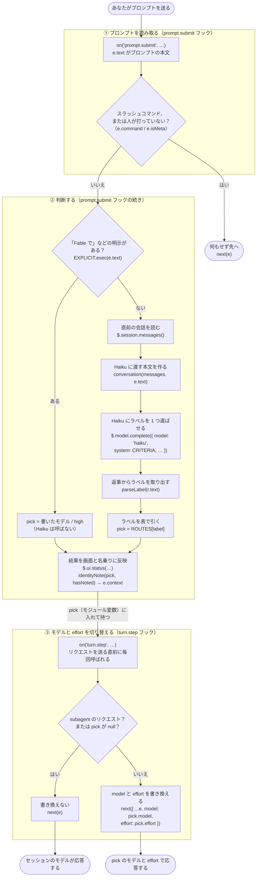

# model-router 実装解説

この文書は、model-router プラグインが「どう動くか」「なぜその作りにしたか」を説明します。

- 対象のバージョン: 0.3.0（`main` に入っている版）
- 設計の正式な記録は [spec](superpowers/specs/2026-11-10-model-router-design.md)。この文書は、読み物として書き直した解説です。
- 使い方だけ知りたいときは、リポジトリ直下の [README](../README.md) を読んでください。

## 1. 何をするプラグインか

Claude Code に、プロンプトを送るたびに、次の 2 つを自動でさせます。

1. プロンプトの種類（設計・調査 / 実装 / レビュー / 雑談）と難易度を、**Haiku が分類する**。
2. 分類の結果に応じて、**そのターンのメインのモデルと effort を切り替える**。

たとえば、「複数リージョンの決済システムの設計方針を考えて」は Opus / xhigh、「README の誤字を直して」は Sonnet / high、「こんにちは」は切り替えなし、のようになります。元の要望は [docs/intent.md](intent.md) にあります。

**やらないこと**
- 切り替えは、そのターンだけです。次のプロンプトで、もう一度分類します。
- アプリのモデル表示や、コミットの署名は変えません（8 章）。
- subagent の作業には手を出しません。

## 2. 全体の流れ

### 2.1 mod の基本（読む前に知っておくこと）

mod は、Claude Code の中で動く TypeScript のモジュールです。`register` という関数を 1 つ書き、その中で、どのイベントで何をするかを登録します。

```ts
export const register: Register = on => {
  on('イベント名', async ($, e, next) => {
    // e    : そのイベントの入力（プロンプトの本文、送ろうとしているモデル名など）
    // $    : Claude Code の機能を呼ぶ窓口（$.model.complete で別のモデルを呼ぶ、など）
    // next : 処理を先へ進める。next(e) ならそのまま、next({ ...e, x }) なら入力を書き換えて進める
    return next(e)
  })
}
```

この登録した関数を「フック」と呼びます。model-router が使うフックは、次の 2 つだけです。

| フック | 呼ばれるとき | 入力 `e` にあるもの |
|--|--|--|
| `prompt.submit` | プロンプトを送った直後（モデルを呼ぶ前）に 1 回 | プロンプトの本文（`e.text`） |
| `turn.step` | モデルへのリクエストを送る直前に、毎回（1 ターンに何度か） | 送ろうとしているモデル名と effort（`e.model`、`e.effort`） |

### 2.2 フローチャート: 読み取る → 判断する → 切り替える



### 2.3 各段とコードの対応

| 段 | やること | コード（[hooks/register.ts](../hooks/register.ts)） |
|--|--|--|
| ① 読み取る | プロンプトの本文を受け取る。スラッシュコマンドなどは素通しする | `on('prompt.submit', …)` の先頭。`e.text` が本文、`e.command` / `e.isMeta` で素通しを判断 |
| ② 判断する | (a) モデルの明示があれば、それを使う | `EXPLICIT`（正規表現）と `EXPLICIT.exec(e.text)` |
| | (b) なければ、判断基準と直前の会話を Haiku に渡して、ラベルを選ばせる | `CRITERIA`（判断基準の文章）、`conversation()`（会話を整える）、`$.model.complete()`（Haiku を呼ぶ）、`parseLabel()`（返事からラベルを拾う） |
| | (c) ラベルをモデルと effort に置き換え、`pick` に入れる | `ROUTES`（ラベル → モデルと effort の表）。`pick = ROUTES[label]` |
| | (d) 結果を、ステータス行と名乗りの添え書きに出す | `$.ui.status()`、`identityNote()`、`next({ ...e, context })` |
| ③ 切り替える | リクエストを送る直前に、`pick` の値で model と effort を書き換える | `on('turn.step', …)`。`next({ ...e, model: pick.model, effort: pick.effort })` |

分類に失敗したとき（Haiku が答えない、返事にラベルがない、例外）と、雑談のときは、`pick` が `null` になります。③ は何も書き換えず、セッションのモデルのまま応答します。

### 2.4 なぜフックを 2 つに分けるのか

ポイントは、フックが 2 つに分かれていることです。

- `prompt.submit` は、**プロンプトの本文**を読めるが、モデルは変えられない。
- `turn.step` は、**モデルを変えられる**が、プロンプトの本文を読めない（入力にあるのは、モデル名や effort、メッセージ数など）。

そこで、`prompt.submit` で分類した結果を変数 `pick` に入れておき、`turn.step` がそれを読む、という受け渡しにしています。

## 3. ファイル構成

```
model-router/
├── .claude-plugin/
│   ├── plugin.json            # 名前・バージョン・説明
│   └── marketplace.json       # マーケットプレイス kjman678-plugins
├── hooks/
│   ├── hooks.json             # {"modules": ["./register.ts"]}
│   ├── register.ts            # 本体（ラベル表と 2 つのフック）
│   └── register.test.ts       # claude plugin test で動かす単体テスト
├── tests/test_static.py       # manifest などの静的な確認
├── docs/
│   ├── intent.md              # 元の要望
│   ├── implementation-guide.md  # この文書
│   └── superpowers/           # 設計（spec）と実装計画
└── README.md
```

- `hooks/hooks.json` は、`modules` に `./register.ts` を 1 つ書いているだけです。この形のプラグインを、Claude Code では **mod** と呼びます。mod は、Claude Code の中で動く hooks モジュールで、エンジンの内部のイベントを直接 hook できます。
- 実装の本体は、[hooks/register.ts](../hooks/register.ts) の約 80 行です。

## 4. コードの解説（`hooks/register.ts`）

### 4.1 ラベルとモデルの対応表

```ts
const ROUTES: Record<string, Route | null> = {
  'design-simple':      { model: 'opus',   effort: 'medium' },
  'design-moderate':    { model: 'opus',   effort: 'high' },
  'design-complex':     { model: 'opus',   effort: 'high' },
  'design-hardest':     { model: 'opus',   effort: 'xhigh' },
  'implement-simple':   { model: 'sonnet', effort: 'high' },
  'implement-moderate': { model: 'opus',   effort: 'high' },
  'implement-complex':  { model: 'opus',   effort: 'xhigh' },
  'review-standard':    { model: 'opus',   effort: 'xhigh' },
  'review-deep':        { model: 'opus',   effort: 'xhigh' },
  'chat-or-question':   null,   // 切り替えない
}
const LABELS = Object.keys(ROUTES)
```

- これが、振り分けのルールのすべてです。変えたいときは、この表を編集します。
- キーの名前が、そのまま Haiku に渡す分類のラベルになります。各ラベルの判断基準は、同じファイルの `CRITERIA` に文章で書いてあり、Haiku にはそれをシステムプロンプトとして渡します（4.2）。
- `null` は「切り替えない」で、そのターンは、セッションに設定されたモデルのまま動きます。

| 種類 | 軽い | | | 重い |
|--|--|--|--|--|
| 設計・調査 | opus / medium | opus / high | opus / high | opus / xhigh |
| 実装 | sonnet / high | opus / high | opus / xhigh | — |
| レビュー | opus / xhigh | opus / xhigh | — | — |

この対応は、`docs/intent.md` の表をもとにしています。ただし、intent.md で Fable としていた複雑な設計と深いレビューは、Opus に替えています（`opus / high`、`opus / xhigh`）。**Fable は、プロンプトに「Fable で」と書いたときだけ使います**（4.2 の②）。

### 4.2 判定の優先順位（`prompt.submit`）

```ts
on('prompt.submit', async ($, e, next) => {
  if (e.command || e.isMeta) return next(e)

  const explicit = EXPLICIT.exec(e.text)
  if (explicit) {
    pick = { model: explicit[1]!.toLowerCase(), effort: 'high' }
  } else {
    try {
      const messages = await $.session.messages().catch(() => [])
      const r = await $.model.complete({
        model: 'haiku',
        system: CRITERIA,
        prompt: conversation(messages, e.text),
        maxTokens: 20,
        effort: 'low',
        timeoutMs: 10000,
      })
      const label = r.isAnswered ? parseLabel(r.text) : undefined
      pick = label === undefined ? null : (ROUTES[label] ?? null)
    } catch {
      pick = null // 分類に失敗したら、切り替えずにセッションのモデルで続ける。
    }
  }
  ...
})
```

上から順に、最初に当てはまったものが採用されます。

| 順 | 条件 | 動き |
|--|--|--|
| ① | スラッシュコマンド（`e.command`）、または人が打っていないプロンプト（`e.isMeta`） | 判定を変えず、そのまま通す |
| ② | 「Fable で」「opus を使って」「sonnet に切り替えて」のような、モデルの明示 | そのモデルと effort high。**分類は呼ばない** |
| ③ | 上のどれでもない | Haiku で分類して、`ROUTES` で引く |

- ②で分類を呼ばないのは、モデルの名前が書いてあれば、それで確実に決まるためです。
- ③では、`$.model.complete` で Haiku（effort low、最大 20 トークン、10 秒まで）を 1 回呼びます。渡すのは次の 2 つです。
  - システムプロンプト: `CRITERIA`（各ラベルの判断基準と、答え方の指示）
  - 本文: 直前の会話（同じ側の発言が続いたら 1 件にまとめたうえで、本文のある最後の 4 件、つまり 2 往復。1 発言 500 文字まで。ツールの出力と、このプラグインの添え書きは除く）を `<conversation>`、今回のプロンプトを `<request>` で囲んだもの
- 「続けて」のような短い続きも、会話を見た Haiku が、直前の作業と同じラベルを選びます。以前は先頭の語を正規表現で見ていましたが、「その件だけど…」のような言い方を取りこぼすため、0.3.0 でやめました。
- 構造化出力は mod の API にないので、ラベルを 1 語で答えさせ、返事に含まれるラベルを拾います。
- ③で、返事にラベルがなかったときと、API が失敗したときは、`pick = null` にして、切り替えずにセッションのモデルで続けます。分類の失敗で、作業が止まることはありません。

### 4.3 モデルの書き換え（`turn.step`）

```ts
on('turn.step', async function* ($, e, next) {
  if (e.agentId || !pick) return yield* next(e)
  return yield* next({ ...e, model: pick.model, effort: pick.effort })
})
```

- `turn.step` は、**モデルにリクエストを送る直前に、毎回**呼ばれます。1 つのターンの中で、ツールを呼ぶたびにリクエストが何回も出るので、その都度、呼ばれます。
- `next(e)` は、「このフックの下にあるもの（エンジン本来の動き）」を呼ぶ関数です。`next({ ...e, model, effort })` のように、`model` と `effort` だけ差し替えた入力を渡すと、そのリクエストは指定したモデルに送られます。入力のほかの項目（メッセージ数、ターンの番号など）は固定で、書き換えられません。
- `async function*` と `yield*` を使うのは、この種類のフックは、応答が少しずつ流れてくる（ストリーミング）ためです。`yield* next(...)` で、流れてきたものをそのまま上に渡します。
- `e.agentId` があるのは、subagent のリクエストです。subagent は、自分のモデルを持っているので、触りません。
- **effort の書き換えは、次のステップに引き継がれません。** だから、毎回、`pick.effort` を指定しています。

### 4.4 名乗りの添え書き（`identityNote`）

切り替えたターンのプロンプトに、短い添え書きをつけて、モデルの名乗りを実際に合わせる処理です。

```ts
const note = identityNote(pick, hasNoted)
if (!note) return next(e)
hasNoted = true
return next({ ...e, context: [...(e.context ?? []), note] })
```

- 切り替えると、そのターンは Fable が応答するのに、システムが示す「あなたは Sonnet 5.5 で動いています」は、セッションの設定のままで、Fable が自分を Sonnet だと答えてしまいます（実際にそうなりました）。
- そこで、`e.context`（モデルだけが読み、画面には出ない追加の文）に、「このターンは Fable が応答している。…自分のモデルを問われたら Fable と答える」と加えます。
- 前のターンで添え書きをしていたら、切り替えないターンでは、「このターンは切り替えなし」という添え書きで打ち消します。**一度も切り替えていないあいだは、何も加えません。**
- 添え書きは、そのターンのプロンプトの末尾に付くだけなので、会話の前のほうは書き換えず、プロンプトキャッシュを崩しません。

### 4.5 ステータス行

```ts
$.ui.status(pick ? `このターン: ${NAMES[pick.model] ?? pick.model} / ${pick.effort}（画面のモデル表示とは別）` : undefined)
```

プロンプトボックスの下に、`このターン: Fable / high（画面のモデル表示とは別）` のように出ます。切り替えないターンは、`undefined` を渡して、表示を消します。

### 4.6 状態の持ち方

`pick` と `hasNoted` は、モジュールの変数です。そのため、mod を**再読み込みすると消えます**。影響は、ターンの途中で再読み込みしたときに、そのターンの残りが切り替わらない程度なので、`$.state`（セッションが保持する値）にはしていません（コードに `ponytail:` のコメントで残してあります）。

### 4.7 削減額の記録（`hooks/savings.ts`）

`/savings` で表示する削減額は、次のように数えています。設計は [2026-11-16-savings-design.md](superpowers/specs/2026-11-16-savings-design.md)。

- `turn.step` で、メインのリクエストの結果の `usage`（応答したモデル、入力・出力・キャッシュ読み込み・キャッシュ書き込み）を足し込みます。subagent は、どちらの方式でも同じなので数えません。
- 分類の Haiku の `usage` は、実際の側にだけ足します。
- 基準の側は、入力と出力は同じ数です。直前のリクエストとモデルが変わったリクエストでは、キャッシュ書き込みのうち直前のプロンプトまでの分を、読み込みに移します（基準のモデルなら書き直さずに済んだため）。
- 料金は、表示のたびに単価表で計算します。トークン数だけを `$.store` に保存するので、単価表を直せば過去の分にも反映されます。キャッシュ書き込みは、両側とも 1 時間の単価です。
- 累計の「直前のリクエスト」は、このセッションのものを使います。前のセッションの最後のモデルと比べて、切り替えたと誤って数えないためです。
- `$` を受け取る関数は、エンジンの決まりでファイルの一番上に置く必要があるので、保存は `addToTotal` と `readTotal` にまとめています。

## 5. テスト

| 種類 | 実行 | 内容 |
|--|--|--|
| 静的な確認 | `python3 -m unittest discover tests` | plugin.json と marketplace.json の整合、`hooks.json` が mod だけを読むこと、`register.ts` が 2 つのフックを持つこと |
| mod の単体テスト | `claude plugin test .` | Haiku の返事と会話を差し替えて、下の 18 ケースを確かめる。API は呼ばない。2.1.321 以上が必要 |
| 検証 | `claude plugin validate .` | `prompt.submit` と `turn.step` を hook し、`$.model.complete`、`$.session.messages`、`$.ui.status` を呼ぶことの確認 |

`claude plugin test` の 18 ケース（`hooks/register.test.ts`）:

1. レビューのプロンプトで、Opus / xhigh に切り替わる
2. どのラベルでも、分類の結果は Fable にならない（Fable は明示したときだけ）
3. 雑談では、切り替えない
4. 明示したモデルは、分類より優先される（Haiku を呼ばない）
5. subagent のステップは、書き換えない
6. 分類が失敗したら、切り替えない
7. 切り替えたターンに、名乗りの添え書きがつく
8. 雑談のターンには、切り替えるまで添え書きがつかず、切り替えたあとの雑談では打ち消しの添え書きがつく
9. Haiku を、effort low、最大 20 トークン、10 秒までで呼び、システムプロンプトにすべてのラベルの基準が入る
10. 「続けて」は、直前の会話とともに分類に渡り、直前と同じ作業として切り替わる
11. 会話は、本文のある最後の 4 件だけを、各 500 文字までで渡す
12. このプラグインの添え書きは、会話から除く
13. 今回のプロンプトが会話の最後に入っていても、二重に渡さない
14. 返事の前後に余計な文字（バッククォート、句読点、改行）があっても、ラベルを拾う
15. ラベルでない返事では、切り替えない
16. 応答のない呼び出しでは、切り替えない
17. 会話が読めなくても、今回のプロンプトだけで分類する
18. ツールを使ったターンのように同じ側の発言が続いても、1 件にまとめるので、2 往復ぶんが渡る

**テストでできないこと:** Haiku の返事は差し替えているので、Haiku が基準どおりのラベルを選ぶかは、テストでは確かめられません。それは、実機で見る必要があります。

## 6. 方式を 3 回変えた経緯

最初の案から、実際に動かして確かめながら、3 回、方式を変えました。

| 順 | 方式 | 結果 |
|--|--|--|
| 1 | モデル×effort ごとの skill を、メインの Sonnet が呼ぶ | **失敗。** Claude が自分で（Skill ツールで）呼んだ skill では、`model` が効かなかった。デスクトップで、auto と default の両方で、記録上のモデルが変わらなかった |
| 2 | Agent ツールに `model` と `effort` を渡して、作業を subagent に任せる | **動いた。** デスクトップで、10 ケースすべて期待どおり。ただし、依頼文に文脈を書き直す必要があり、途中経過が見えない |
| 3 | mod の `turn.step` で、メインのモデルそのものを切り替える（**現行**） | 動いた。文脈の書き直しが要らず、途中経過もそのまま見える |

- 1 から 2 への変更は、「skill の `model` は、Claude が呼んだときには効かない」という、実機で確かめた事実によるものです。モデルが自分で「Sonnet に切り替わりました」と答えても、実際の送り先は変わっていませんでした。**切り替わったかどうかは、モデルの自己申告ではなく、セッション記録の `message.model` で確かめる**、という教訓が得られました。
- 2 から 3 への変更は、`turn.step` というフックを知ったことによるものです。subagent 方式の長所（モデルが変わっても会話全体のキャッシュを読み直さない）は失いますが、それ以上に、文脈を渡し直す必要がなくなる利点が大きいと判断しました。
- 詳しい検証の記録は、spec の 7 章と 9 章にあります。

## 7. 実機で確認した結果

デスクトップアプリ（Claude Code 2.1.321）で、セッション記録の `requestedModel`、`message.model`、`effort` を見て確かめました。

| プロンプト | 想定 | 実際 |
|--|--|--|
| こんにちは | 切り替えない | sonnet-5-5 / high（セッションのモデルのまま） |
| README.md の構成案を簡単に考えて | opus / medium | opus-5-5 / medium |
| Fable で、一言あいさつして | fable / high | fable-5-2 / high |
| Fable で、あなたのモデル名を一言で教えて | fable / high、答えは Fable | fable-5-2 / high、答えは「Fable」 |
| 新しく開いたセッションに、インストールした版で「Fable で、一言あいさつして」 | fable / high | fable-5-2 / high |

**確認できていないこと**
- 0.3.0 の分類（判断基準と直前の会話を渡す方式）の実機での精度。実装・レビューの分類と、「続けて」の扱いは、単体テストでは通っているが、実機では試していない
- auto モードでの動き、CLI（`claude -p`）での動き
- 切り替えによる費用の増減（測っていない）

## 8. 制約と、知っておくべきこと

### 8.1 アプリのモデル表示は変わらない

`turn.step` が変えるのは、**そのリクエストの送り先だけ**です。次のものは、セッションに設定されたモデルのままです。

- アプリ下部の「Opus 5.5 高」のようなモデル表示
- システムプロンプトの名乗り（添え書きで補っている。4.4）
- コミットの署名（`Co-Authored-By: Claude …`）

mod から、セッションに設定されたモデルを変える方法は、型定義の範囲では見つかりませんでした。実際に切り替わったかは、ステータス行の「このターン: …」と、セッション記録の `message.model` で確かめます。

### 8.2 費用

- モデルが変わるターンでは、**プロンプトキャッシュがモデルごとに分かれている**ため、会話全体をキャッシュなしで読み直します。長い会話ほど影響が大きくなります。実際に、この設計の作業をしたセッションでは、Fable の呼び出しが数回なのに、キャッシュの新規書き込みが約 35 万トークンあり、費用は約 5.5 ドルになりました（セッション全体では約 22 ドルで、Opus と Sonnet が各約 8 ドル台）。
- Haiku の分類が、プロンプトごとに 1 回加わります。費用はごくわずかです（このセッション全体で約 0.02 ドル）。
- 「安いモデルに下ろして節約する」つもりでも、切り替えの回数が多いと、かえって高くなることがあります。**測ってはいません**（spec の 6 章）。

### 8.3 そのほか

| 項目 | 内容 |
|--|--|
| 要件 | Claude Code の新しい版が必要。mod が動くのは、ターミナルと Claude Desktop の Code タブ。確認できているのは 2.1.321 で、v2.1.309 以上という要件は、公式ドキュメントでは未確認 |
| 読み込みのタイミング | インストールした版は、**新しく開いたセッション**で読み込まれる。動いているセッションには、`/reload-plugins` をしても入らなかった |
| 分類の費用 | プロンプトごとに Haiku を 1 回呼ぶ。直前 4 件ぶん（最大 2,000 文字）の会話も毎回渡す |
| スラッシュコマンド | そのターンでは判定を変えず、添え書きもしない。直前の判定で切り替わったターンは、名乗りが合わない |
| 添え書き | モデルへの指示なので、必ず従うとは限らない |
| 指定のモデルが使えない | 組織の `availableModels` の制限や、プランで使えないモデルは、Claude Code が別のモデルに置き換える |
| 他の mod との併用 | 別の mod が `turn.step` で `model` を書き換えると、後に動くほうが優先される |

## 9. 使い方と、変え方

**入れる**
- マーケットプレイスから: このリポジトリをマーケットプレイス（`kjman678-plugins`）として追加し、`model-router@kjman678-plugins` をインストールします。
- 試すだけなら: `claude --plugin-dir <このリポジトリ>`

**振り分けを変える**
- `hooks/register.ts` の `ROUTES` の、モデルと effort を書き換えます。ラベルを増やしたいときは、`ROUTES` にキーを足し、`CRITERIA` にそのラベルの判断基準を 1 行足します。
- 判断の境目を変えたいときは、`CRITERIA` の文章を直します。
- モデルの明示の言い方を増やしたいときは、`EXPLICIT` の正規表現を直します。

**変えたあと**
1. `claude plugin test .` と、`python3 -m unittest discover tests` を実行する。
2. バージョンを上げる（`plugin.json` と `marketplace.json` の `version` を同じ値にする。上げないと、インストール済みの版が更新されません）。
3. 新しいセッションで、プロンプトを送り、記録の `message.model` で確かめる。

## 10. よくある疑問

**Q. アプリの表示は Opus のままなのに、本当に切り替わっているの？**
はい。送り先のモデルだけが変わっていて、表示は設定のままです（8.1）。ステータス行の「このターン: …」が、そのターンの実際のモデルです。

**Q. 切り替わったモデルが「私は Sonnet です」と答えた**
名乗りの添え書き（4.4）を入れる前の版では、その動きでした。0.2.1 以降は、添え書きで合わせています。ただし、添え書きは指示なので、必ず従うとは限りません。

**Q. 分類が外れたときは？**
モデルを明示すれば、分類より優先されます（例: 「Fable で、…」）。表そのものを変えたいときは、`ROUTES` を編集します。

**Q. なぜ subagent ではなく、メインを切り替えるの？**
subagent は、会話を読めないので、依頼文に文脈を書き直す必要があり、途中経過も見えません。mod なら、会話全体をそのまま使えて、途中経過も画面に流れます（6 章）。代わりに、モデルが変わるたびにキャッシュを読み直す費用がかかります。

**Q. 古い Claude Code でも動く？**
mod 方式は、新しい版が前提です。古い版（確認したのは 2.1.261）には `claude plugin test` もありません。古い版で使いたいときは、subagent 方式（コミット `4ebd3cd` まで）が使えます。
